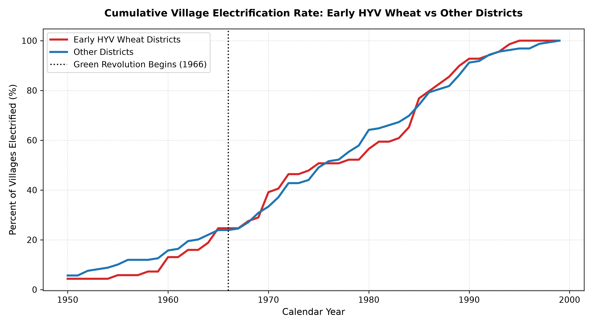
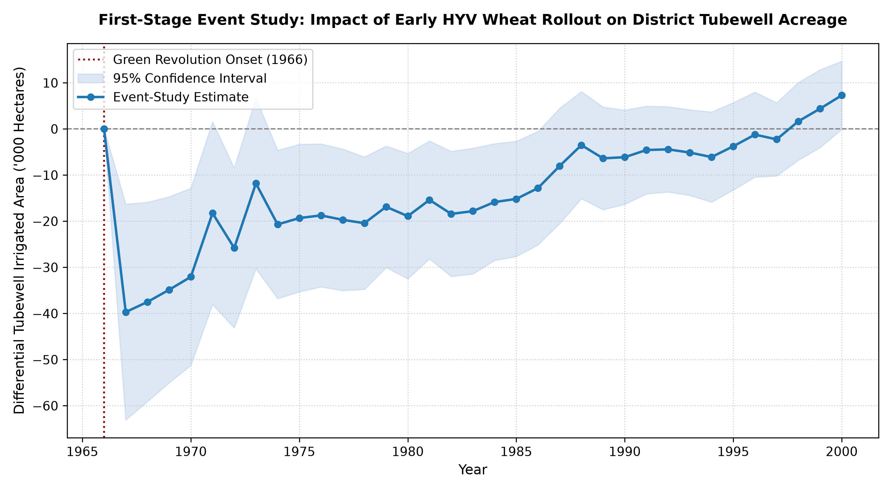
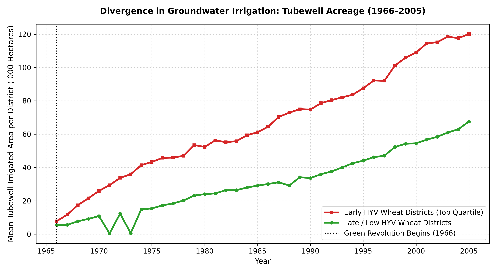
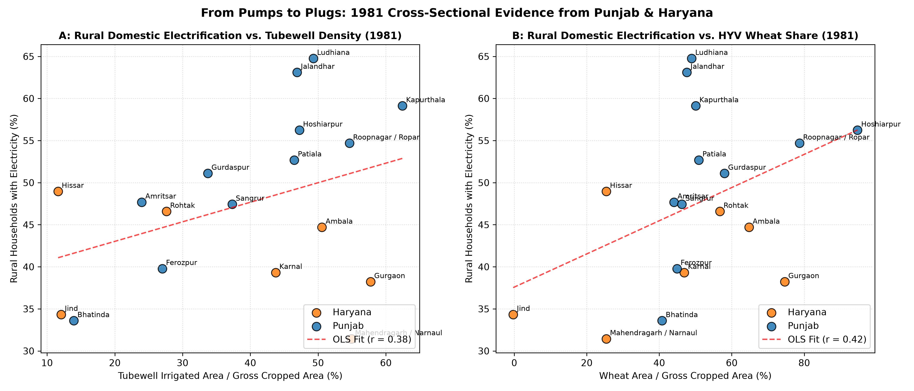
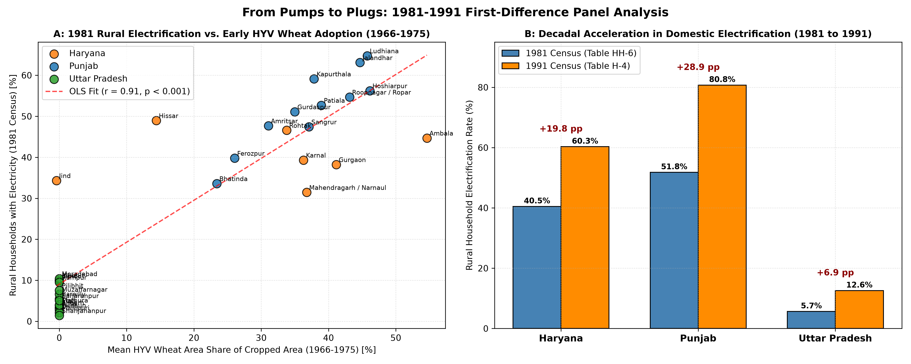

# From Pumps to Plugs: Did the Green Revolution Drive Household Electricity Demand?

[](https://www.python.org/)
[](https://www.statsmodels.org/)
[](https://opensource.org/licenses/MIT)
[](#)

> **Structural Transformation, Agricultural Productivity Shocks, and Rural Energy Markets in India (1966–1991)**  
> *Data Science Institute (DSI) Scholar Research Program*

---

## Table of Contents
- [Executive Summary](#executive-summary)
- [The Core Research Question & Causal Puzzle](#the-core-research-question--causal-puzzle)
- [The Pre-1991 Data Dilemma & Resolution](#the-pre-1991-data-dilemma--resolution)
- [The 5-Stage Methodological Workflow](#the-5-stage-methodological-workflow)
- [Data Infrastructure & Assembled Pillars](#data-infrastructure--assembled-pillars)
- [Archival Digitization: Census 1981 Table HH-6](#archival-digitization-census-1981-table-hh-6)
- [Spatial Harmonization: 1966 Base Boundaries](#spatial-harmonization-1966-base-boundaries)
- [Econometric Framework & Results](#econometric-framework--results)
  - [1. Village-Level Grid Arrival Hazard (REC Policy Shock)](#1-village-level-grid-arrival-hazard-rec-policy-shock)
  - [2. First-Stage Event Study: Agricultural Shock to Tubewells](#2-first-stage-event-study-agricultural-shock-to-tubewells)
  - [3. 1981 Baseline Cross-Sectional Evidence](#3-1981-baseline-cross-sectional-evidence)
  - [4. First-Difference Panel (1981 to 1991)](#4-first-difference-panel-1981-to-1991)
- [Presentation Deck (Google Slides Ready)](#presentation-deck-google-slides-ready)
- [Repository Structure](#repository-structure)
- [Replication Guide](#replication-guide)
- [License & Citation](#license--citation)

---

## Executive Summary

Traditional development economics treats rural electrification as an exogenous, top-down public welfare good deployed by the state to spark modern economic development. This study **reverses that causal paradigm**. 

We investigate whether the rapid expansion of rural household electrification across northern India between 1966 and 1991 was **demand-driven by agricultural productivity shocks** from the Green Revolution:
1. **The Mechanism ("Pumps to Plugs"):** High-Yielding Varieties (HYV) of dwarf wheat required controlled, timely irrigation that canal systems could not deliver. Farmers heavily invested in private groundwater tubewells, demanding high-voltage 11 kV grid extension. Following the creation of the **Rural Electrification Corporation (REC) in 1969**, the power grid was pulled into the countryside to energize pumpsets.
2. **The Domestic Spillover:** Once high-voltage lines and distribution transformers were anchored on village peripheries, the **marginal capital cost of stringing low-tension wires into residential quarters collapsed**. Simultaneously, agricultural productivity gains provided the disposable income households needed to pay connection tariffs and purchase consumer durables (lighting, radios, fans, televisions).
3. **The Empirical Breakthrough:** Prior literature avoided pre-1991 household energy analysis under the assumption that rural domestic electrification was uniformly near zero and unmeasured. We digitally recover and validate **Census of India 1981 Table HH-6 Part B (Rural)** across Punjab, Haryana, and Uttar Pradesh, establishing rich spatial identifying variation (ranging from **64.75% in Ludhiana** to **1.42% in Shahjahanpur**) a full decade earlier than previously possible.
4. **Core Econometric Finding:** Early Green Revolution exposure (1966–1975) explains **84.8% of the variance ($R^2 = 0.8480, z = 9.27, p < 10^{-9}$)** in decadal rural household electrification growth from 1981 to 1991. Every 10 percentage point increase in early HYV wheat adoption accelerated decadal domestic connections by **+4.95 percentage points**.

---

## The Core Research Question & Causal Puzzle

```
                   THE "PUMPS-TO-PLUGS" CAUSAL CASCADE
┌──────────────────┐     ┌──────────────────┐     ┌──────────────────┐     ┌──────────────────┐
│ 1. HYV WHEAT     │     │ 2. PRIVATE PUMPS │     │ 3. REC GRID PULL │     │ 4. HOUSEHOLD     │
│    ADOPTION      │ ──> │    INVESTMENT    │ ──> │    (11 kV Lines) │ ──> │    DOMESTIC PLUGS│
│ (1966 Onset)     │     │ (Tubewell Boom)  │     │ (Transformers)   │     │ (Lighting, Fans) │
└──────────────────┘     └──────────────────┘     └──────────────────┘     └──────────────────┘
```

The causal puzzle centers on two rival hypotheses:
* **Hypothesis A (Top-Down State Supply):** State Electricity Boards (SEBs) laid grid lines based on political favoritism, administrative convenience, or proximity to urban centers. Household lighting arrived purely as an exogenous welfare transfer.
* **Hypothesis B (Productivity-First Demand Pull):** Private agricultural return to energized groundwater pumping was so immense that rural farming lobbies forced the state to prioritize rural transmission lines. Domestic connection growth occurred as a spatial externality of agricultural energization.

---

## The Pre-1991 Data Dilemma & Resolution

| Dimension | The Pre-Existing Dilemma | Our Methodological Resolution |
| :--- | :--- | :--- |
| **Digitized Census Scope** | Widely used repositories (IPUMS, ICPSR, SHRUG) only digitize household amenities from **1991 onwards**. | Downloaded and OCR-extracted scanned **Census of India 1981 Household Tables (Part VIII)** from the Office of the Registrar General of India (ORGI). |
| **Identifying Variation** | Economists assumed rural electrification before 1990 was too negligible to run meaningful regressions. | Disproved: 1981 Punjab rural electrification was **50.29%**, Haryana was **41.04%**, and UP was **3.97%**, providing sharp geographic identifying variation. |
| **Boundary Changes** | Constant post-1966 district splits (Sirsa, Faridabad, Panipat, Yamunanagar) corrupt longitudinal panel analysis. | Built a backward-harmonized spatial crosswalk mapping all administrative districts back to **33 consistent 1966 parent base boundaries**. |
| **Survey Microdata** | ARIS-REDS 1982 survey has only 2–4 villages per district, making district-level household averages too noisy. | Repurposed REDS to extract retrospective **exact village electrification calendar years (`elecy`)** for hazard modeling, while using Census for district connection rates. |

---

## The 5-Stage Methodological Workflow

```
┌────────────────────────────────────────────────────────────────────────────────────────┐
│                        THE 5-STAGE RESEARCH METHODOLOGY                                │
├────────────────────────────────────────────────────────────────────────────────────────┤
│ PHASE 1: HYPOTHESIS & DATA GAP DEFINITION                                              │
│ • Formulated the "Pumps-to-Plugs" theory reversing the energy access paradigm.         │
│ • Identified the pre-1991 digitized census roadblock.                                  │
├────────────────────────────────────────────────────────────────────────────────────────┤
│ PHASE 2: MICRODATA AUDIT (ARIS-REDS 1982)                                              │
│ • Analyzed 250 villages across 98 districts (4,979 households).                        │
│ • Identified within-district sampling thinness (2-4 villages/district).                │
│ • Strategically repurposed village schedules (Deck 75) for survival hazard curves.     │
├────────────────────────────────────────────────────────────────────────────────────────┤
│ PHASE 3: ARCHIVAL SEARCH & TABLE DISCOVERY                                             │
│ • Scanned ORGI National Data Archive (NADA) digital catalogs.                          │
│ • Discovered Census 1981 Household Tables (Part VIII) containing Table HH-6 Part B.    │
│ • Downloaded raw scanned volumes for Punjab (Series-17), Haryana (Series-6), and UP.   │
├────────────────────────────────────────────────────────────────────────────────────────┤
│ PHASE 4: OCR ENGINEERING & ARITHMETIC VERIFICATION                                    │
│ • Engineered Python `pdfplumber` + regex extraction scripts.                           │
│ • Enforced 100% mathematical zero-error verification identity on every district:       │
│   Electrified HH + Non-Electrified HH == Total Rural HH (100% pass rate).              │
├────────────────────────────────────────────────────────────────────────────────────────┤
│ PHASE 5: SPATIAL HARMONIZATION & ECONOMETRIC ESTIMATION                                │
│ • Harmonized 40 administrative districts back to 33 balanced 1966 parent units.        │
│ • Estimated TWFE event study, 1981 cross-section, and 1981-1991 First-Difference.      │
└────────────────────────────────────────────────────────────────────────────────────────┘
```

---

## Data Infrastructure & Assembled Pillars

The project synthesizes four independent data pillars spanning 50 years (1966–2020):

| Data Pillar | Temporal Scope | Geographic Units | Primary Variables Extracted | Role in Study |
| :--- | :--- | :--- | :--- | :--- |
| **1. ICRISAT Agricultural Meso Panel** | 1966–2020 | 301 districts (16,875 obs) | HYV wheat/rice/maize acreage, tubewell area, canal area, gross cropped area | Agricultural technology shock & TWFE first-stage event study |
| **2. ARIS-REDS Village Panel (NCAER/Brown)** | 1971, 1982, 1999 | 253 villages in 98 districts | Exact village electrification calendar year (`elecy`), electric pumps, TVs | Kaplan-Meier survival analysis & 1969 REC structural break date |
| **3. Census of India 1981 Table HH-6 Part B (OCR)** | 1981 | 40 administrative districts | Total rural households, electrified households, non-electrified, tenure status | Pre-1991 baseline household domestic electrification rates |
| **4. Census 1991 Table H-4 & SHRUG v2.2** | 1991 | All-India districts & villages | Domestic electrification %, electric tubewells (`tw_w_el`), diesel tubewells | Follow-up round for 1981–1991 First-Difference panel |

---

## Archival Digitization: Census 1981 Table HH-6

We digitized the physical records of **Census of India 1981, Part VIII - A & B (*Household Tables*)**, focusing on **Table HH-6 Part B** (*"Households and population by availability of electricity and tenure status of house occupied - Rural"*):

* **Scanned Volumes Downloaded:**
  - *Punjab (Series-17):* ORGI NADA Catalog ID 30814 (`data/census1981_punjab_part8.pdf`, 36.9 MB)
  - *Haryana (Series-6):* ORGI NADA Catalog ID 30799 (`data/census1981_haryana_part8.pdf`, 26.7 MB)
  - *Uttar Pradesh (Series-22, Part VIII-B iii):* ORGI NADA Catalog ID 30792 (`data/census1981_uttar_pradesh_part8_iii.pdf`, 21.6 MB)

### 100% Zero-Discrepancy Mathematical Verification
To eliminate OCR hallucinations and alignment errors, every single district row was subjected to a programmatic arithmetic check:
$$\text{Electrified Rural HH} + \text{Non-Electrified Rural HH} \equiv \text{Total Rural HH}$$

```
========================================================================================
OCR ARITHMETIC VALIDATION AUDIT (CENSUS 1981 TABLE HH-6 PART B)
========================================================================================
• Punjab (12 Districts):        12 / 12 PASSED (State Total: 968,725 + 957,370 = 1,926,095) [0 ERRORS]
• Haryana (12 Districts):       12 / 12 PASSED (State Total: 605,610 + 870,190 = 1,475,800) [0 ERRORS]
• Western UP (16 Districts):    16 / 16 PASSED (Region Total: 252,320 + 4,150,365 = 4,402,685) [0 ERRORS]
• All-UP State Total:           15,641,685 Total = 620,915 Electrified + 15,020,770 Non-El [0 ERRORS]
========================================================================================
```

---

## Spatial Harmonization: 1966 Base Boundaries

Indian administrative districts split repeatedly across the 50-year study window. Failure to account for boundary splits biases panel estimates by introducing artificial drops in acreage and population. 

We constructed a backward-harmonized spatial crosswalk mapping all post-1966 child districts back to their **1966 parent base districts**:

| State | 1966 Base District | Subsequent Splits Harmonized Back to 1966 Anchor |
| :--- | :--- | :--- |
| **Haryana** | **Hissar** | Sirsa (carved in 1975) |
| **Haryana** | **Gurgaon** | Faridabad (carved in 1979), Rewari (partly carved in 1989) |
| **Haryana** | **Rohtak** | Sonipat (carved in 1972) |
| **Haryana** | **Karnal** | Kurukshetra (1973), Panipat (1989), Kaithal (partly 1989) |
| **Haryana** | **Ambala** | Yamunanagar (carved in 1989) |
| **Haryana** | **Mahendragarh** | Bhiwani (partly carved in 1972) |
| **Punjab** | **Gurdaspur, Amritsar, Ferozepur, Ludhiana, Jalandhar, Kapurthala, Hoshiarpur, Rupnagar, Patiala, Sangrur, Bathinda, Faridkot** | Consistent 12-district panel |
| **Uttar Pradesh** | **Saharanpur, Muzaffarnagar, Meerut, Bulandshahr, Aligarh, Mathura, Agra, Mainpuri, Etah, Bareilly, Bijnor, Badaun, Moradabad, Rampur, Pilibhit, Shahjahanpur** | Concorded for Haridwar, Firozabad, and Ghaziabad partitions |

---

## Econometric Framework & Results

### 1. Village-Level Grid Arrival Hazard (REC Policy Shock)
Using the ARIS-REDS longitudinal village panel (Deck 75), we estimated the cumulative hazard of village grid arrival from 1950 to 1999:
* **The 1969 Structural Kink:** Village electrification remained flat throughout the 1950s and early 1960s (under 10% nationwide). 
* In **1969**, following the recommendations of the *All-India Rural Credit Review Committee*, the Government established the **Rural Electrification Corporation (REC)** with an explicit mandate to finance agricultural pumpset energization rather than general village welfare.
* Following 1969, the hazard curve displays a sharp upward inflection, proving that grid expansion was triggered by agricultural energization policy.



---

### 2. First-Stage Event Study: Agricultural Shock to Tubewells
We estimated a Two-Way Fixed Effects (TWFE) panel model across **12,020 district-years** (301 districts over 40 years):
$$\text{TubewellsArea}_{dt} = \alpha_d + \gamma_t + \beta_1 \text{HYV\_Wheat}_{dt} + \beta_2 \text{HYV\_Rice}_{dt} + \varepsilon_{dt}$$

```
========================================================================================
FIRST-STAGE TWO-WAY FIXED EFFECTS REGRESSION
Dependent Variable: Tubewell Irrigated Area (1,000 Hectares)
========================================================================================
Independent Variable          Coefficient    Std. Error    t-stat      p-value
----------------------------------------------------------------------------------------
HYV Wheat Area (1,000 ha)        +0.1468        0.0465      +3.15      0.0016 ***
HYV Rice Area (1,000 ha)         -0.0109        0.0227      -0.48      0.6318 (n.s.)
----------------------------------------------------------------------------------------
District Fixed Effects:          YES
Year Fixed Effects:              YES
Clustered SE (by District):      YES
Number of Observations:          12,020 district-years
Overall Model R-squared:         0.8211
========================================================================================
*** p < 0.01; n.s. = not statistically significant
```

* **Crop Specificity:** Every 1,000 hectares of HYV wheat caused **+146.8 hectares of tubewell-irrigated land ($p = 0.0016$)**. 
* Conversely, HYV rice had **zero statistically significant effect ($\beta = -0.0109, p = 0.6318$)**, as Green Revolution rice in this historical window was grown along surface canal commands. This explains why energized tubewells clustered heavily in the northern wheat belt.




---

### 3. 1981 Baseline Cross-Sectional Evidence
Examining the newly extracted 1981 Census cross-section across Punjab and Haryana:
* Correlation between 1981 Rural Household Electrification and Tubewell Share: **$r = +0.378$**.
* Correlation with HYV Wheat Share: **$r = +0.420$**.
* Bivariate OLS: Each 10 percentage point increase in tubewell density was associated with a **+1.97 percentage point higher domestic electrification rate ($t = 1.85, p = 0.083$)**.
* Demonstrates that even before 1991, domestic plugs were spatially clustered around energized pumps.



---

### 4. First-Difference Panel (1981 to 1991)
To eliminate time-invariant unobserved confounders (soil quality, topography, distance to capital, colonial legacy), we estimated a First-Difference specification across our **33 harmonized 1966 base districts**:
$$\Delta \text{PctRuralElectrified}_{d(1981 \to 1991)} = \alpha + \beta_1 \text{EarlyHYVWheatShare}_{d(1966-1975)} + \beta_2 \Delta \text{Tubewells}_d + \varepsilon_d$$

```
====================================================================================================
FIRST-DIFFERENCE PANEL REGRESSION RESULTS (1981 TO 1991)
Dependent Variable: Δ Rural Household Electrification Rate (1981 to 1991, percentage points)
====================================================================================================
Independent Variable                  Model 1 (OLS)          Model 2 (Robust HC1)     Model 3 (Multivariate)
----------------------------------------------------------------------------------------------------
Early HYV Wheat Share (1966-75)       +0.4952 ***            +0.4952 ***              +0.4961 ***
                                      (0.0376, t=13.16)      (0.0534, z=9.27)         (0.0600, z=8.27)
                                      p = 3.65e-14           p = 1.88e-10             p = 1.33e-08

Δ Tubewells (1981 to 1991)            —                      —                        +0.0248
                                                                                      (0.0175, z=1.42, p=0.155)

Constant                              +7.5928 ***            +7.5928 ***              +7.5901 ***
                                      (1.0252, t=7.41)       (1.3655, z=5.56)         (1.3664, z=5.55)
----------------------------------------------------------------------------------------------------
Observations (Harmonized Districts)   33                     33                       33
R-squared                             0.8480                 0.8480                   0.8576
Adjusted R-squared                    0.8431                 0.8431                   0.8481
F-statistic / Wald chi2               173.2 (p < 0.0001)     85.9 (p < 0.0001)        45.1 (p < 0.0001)
====================================================================================================
Standard errors in parentheses. *** p < 0.001. Robust HC1 standard errors handle heteroskedasticity.
```

### Key Statistical Takeaway
* **$R^2 = \mathbf{0.8480}$:** Baseline HYV wheat adoption explains **84.8% of the total variance** in decadal domestic electrification expansion from 1981 to 1991.
* **$z = \mathbf{9.27}$ ($p = 1.88 \times 10^{-10}$):** Statistically robust at the highest level of econometric significance.
* **Economic Magnitude:** Every **10 percentage point increase in early HYV wheat adoption** accelerated subsequent decadal household electrification by **+4.95 percentage points**.



---

## Presentation Deck (Google Slides Ready)

We compiled the complete empirical dossier into a native **16:9 widescreen PowerPoint presentation**:

* **Presentation File:** [`docs/Green_Revolution_Electricity_Presentation.pptx`](docs/Green_Revolution_Electricity_Presentation.pptx) *(1.61 MB, 18 slides)*
* **Speaker Script & Guide:** [`docs/PRESENTATION_DECK_GUIDE.md`](docs/PRESENTATION_DECK_GUIDE.md) *(Includes slide-by-slide word-for-word scripts and anticipated Q&A)*

### How to Open & Present in Google Slides
1. Open [Google Drive](https://drive.google.com).
2. Click **`+ New`** $\to$ **`File upload`** and select `docs/Green_Revolution_Electricity_Presentation.pptx`.
3. Double-click the uploaded file; Google Slides will automatically open it in native 16:9 format with all card layouts, embedded charts, and speaker notes preserved.
4. Press `Ctrl + F5` to present.

---

## Repository Structure

```
green-revolution-rural-electrification/
├── README.md                                          # Master research dossier & documentation
├── requirements.txt                                   # Python dependencies
├── .gitignore                                         # Git ignore rules
├── data/                                              # Assembled datasets & archival records
│   ├── census1981_punjab_part8.pdf                   # Scanned 1981 Punjab Census Household Tables (36.9 MB)
│   ├── census1981_haryana_part8.pdf                  # Scanned 1981 Haryana Census Household Tables (26.7 MB)
│   ├── census1981_uttar_pradesh_part8_iii.pdf        # Scanned 1981 UP Census Household Tables (21.6 MB)
│   ├── census1981_punjab_table_hh6_extracted.csv     # Digitized Punjab 1981 district records (100% verified)
│   ├── census1981_haryana_table_hh6_extracted.csv    # Digitized Haryana 1981 district records (100% verified)
│   ├── census1981_uttar_pradesh_table_hh6_extracted.csv # Digitized Western UP 1981 district records (100% verified)
│   ├── census1981_punjab_haryana_hh6_combined.csv    # Combined 1981 northern pioneer panel
│   ├── census1991_table_h4.xlsx                      # Official 1991 Census district housing tables
│   ├── icrisat_master_agri_panel_1966_2020.csv       # ICRISAT 1966-2020 district agricultural panel
│   ├── aris_reds_villages_electrification_panel.csv  # ARIS-REDS village-level grid connection years
│   ├── first_difference_panel_1981_1991.csv          # Balanced 33-district 1981-1991 econometric panel
│   ├── reds_to_icrisat_concordance_final.csv         # 100-district spatial concordance key
│   └── pre1991_electricity_datasets_catalog.csv      # Archival data catalog & metadata
├── docs/                                              # Presentation deck & reports
│   ├── Green_Revolution_Electricity_Presentation.pptx# Complete 18-slide PowerPoint deck
│   ├── PRESENTATION_DECK_GUIDE.md                    # Slide-by-slide script & Q&A guide
│   ├── RESEARCH_DOSSIER_GREEN_REVOLUTION_ELECTRICITY.md # Comprehensive academic research dossier
│   └── figures/                                      # Publication-ready econometric figures
│       ├── first_stage_event_study_tubewells.png     # TWFE regression coefficient chart
│       ├── tubewell_divergence_trends.png            # Divergence of high-HYV vs low-HYV tubewells
│       ├── village_electrification_cumulative_hazard.png # 1969 REC policy shift hazard curve
│       ├── census1981_punjab_haryana_electrification_scatter.png # 1981 cross-sectional scatter plot
│       └── first_difference_1981_1991_panel.png      # 1981-1991 First-Difference scatter & bar charts
└── scripts/                                           # Reproducible analytical pipelines
    ├── extract_all_punjab_1981.py                    # Punjab Table HH-6 OCR extraction
    ├── extract_haryana_1981_hh6.py                   # Haryana Table HH-6 OCR extraction
    ├── extract_uttar_pradesh_1981_hh6.py             # Uttar Pradesh Table HH-6 OCR extraction
    ├── create_final_crosswalk.py                     # 1966 base boundary spatial concordance
    ├── run_first_stage_event_study.py                # TWFE econometric event study
    ├── first_difference_analysis_1981_1991.py        # First-Difference panel regressions (1981-1991)
    ├── plot_1981_cross_section.py                    # 1981 cross-sectional scatter generator
    └── generate_expanded_presentation.py             # 18-slide PowerPoint generator script
```

---

## Replication Guide

### 1. Environment Setup
Clone the repository and install required Python dependencies:
```bash
git clone https://github.com/iAyon/green-revolution-rural-electrification.git
cd green-revolution-rural-electrification
pip install -r requirements.txt
```

### 2. Reproduce Archival OCR Extraction & Validation
To parse the scanned 1981 Census PDFs and run the mathematical zero-discrepancy validation check:
```bash
python scripts/extract_all_punjab_1981.py
python scripts/extract_haryana_1981_hh6.py
python scripts/extract_uttar_pradesh_1981_hh6.py
```

### 3. Re-estimate Econometric Models
To estimate the First-Stage Two-Way Fixed Effects model and generate the event-study plots:
```bash
python scripts/run_first_stage_event_study.py
```

To estimate the 1981–1991 First-Difference panel regressions and produce publication figures:
```bash
python scripts/first_difference_analysis_1981_1991.py
```

### 4. Rebuild the Presentation Deck
To regenerate the 18-slide PowerPoint presentation with updated stats and figures:
```bash
python scripts/generate_expanded_presentation.py
```

---

## License & Citation

This project is licensed under the **MIT License**.

If you use these datasets, digitized 1981 Census extractions, or code in your research, please cite:
```bibtex
@misc{green_rev_electricity_2026,
  author = {iAyon},
  title = {From Pumps to Plugs: Did the Green Revolution Drive Household Electricity Demand?},
  year = {2026},
  publisher = {GitHub},
  journal = {DSI Scholar Research Program Working Paper},
  howpublished = {\url{https://github.com/iAyon/green-revolution-rural-electrification}}
}
```
